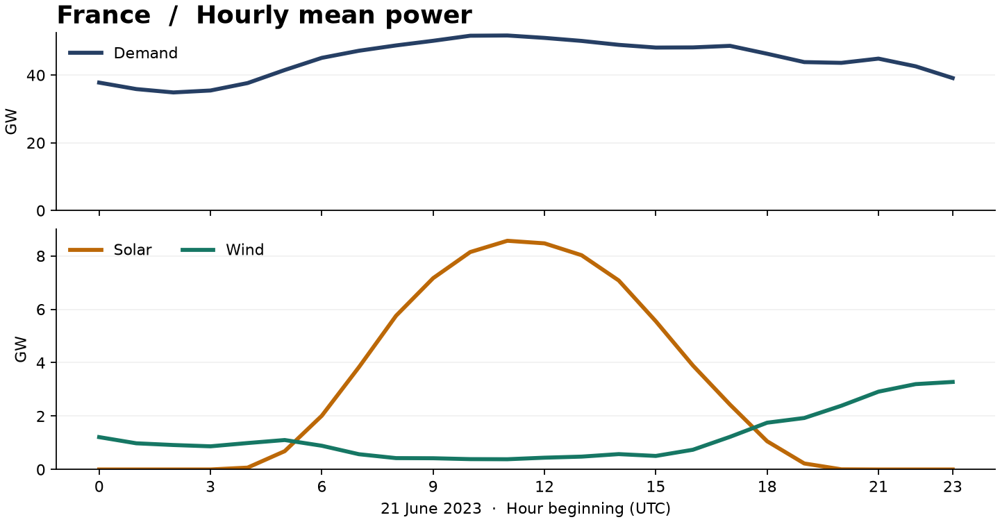

# Assignment 1 · Wind, solar and storage

**Can a better forecast keep the lights on when grid imports are capped at 35 MW?** Build a probabilistic forecaster or a dispatch supervisor. Both tracks operate the same virtual wind farm, solar array, pumped reservoir and battery. Each team chooses one track and exchanges a frozen component with its partner.

**[Assignment and grading PDF](docs/assignment1_energy_basics.pdf)** · [System parameters](configs/course.json) · [Report template](report_template.md) · [Data provenance](data/manifest.json)



*One day in the validation period.* Each point averages two half-hour power observations from RTE. The panels use separate GW scales so the wind and solar profiles are visible below national demand. These are unscaled French measurements. In the assignment, fixed training-period factors map national curves onto the virtual system. [Source CSV](data/rte_validation_day.csv) · [RTE / ODRÉ, Licence Ouverte 2.0](https://odre.opendatasoft.com/explore/dataset/eco2mix-national-cons-def/information/)

## Choose a track

| | A · Forecast the next day | B · Manage the next hour |
|---|---|---|
| Question | Which errors matter when the grid connection binds? | Does tool feedback improve the reserve decision? |
| Implement | A patch Transformer predicting wind, solar and demand at three quantiles | A bounded supervisor choosing among three reserve policies |
| Hold fixed | Deterministic controller and hourly settlement | Forecasts, planner, budgets and settlement |
| Compare | Seasonal → linear → deep | Deterministic search → single LLM choice → full harness |
| Start here | [Predictor interface](starter/forecast/model.py) | [Supervisor interface](starter/harness/manager.py) |

## Follow one hour

At noon, 35 MW of wind and 20 MW of solar cover 40 MW of demand. Sending 10 MW to the pump and 5 MW to the battery balances the bus. After one hour, the reservoir has gained **9 MWh** of potential energy and the battery **4.75 MWh** of internal energy. The remaining **1.25 MWh** went into conversion losses. This synthetic case is the offline demo.

At each decision, observe through the previous hour, issue a 24-hour forecast, plan and execute the first hour. The supervisor updates every six hours or on a published event. Only the evaluator may reveal actual power for settlement. Restore both stores at the end of each episode or report their deficits.

## Review this edition

1. Read page 1 of the [handout](docs/assignment1_energy_basics.pdf), then page 2 for Track A or page 3 for Track B. Page 4 applies to both. Each route is worth 100 points.
2. Inspect the [fixed adapters](tests/adapters.py), [one-hour storage kernel](course/physics.py) and [public checks](tests/test_physics.py).
3. Compare the [hourly output fields](data/hourly_results_header.csv) with the evidence the rubric asks for.

After framework approval, use Python 3.11+ and uv from the repository root:

```bash
uv sync --frozen
uv run python -m course.cli demo --provider mock
uv run pytest -m smoke
```

The demo replays the fixed noon storage action locally. The smoke suite covers hand calculations, storage limits and exclusive modes. The two student interfaces raise `NotImplementedError` until their track is implemented.

## Build from scratch

Pick one track. The course supplies equipment parameters, a one-hour storage kernel, public examples and fixed function signatures. Write the assessed algorithms, comparisons and explanations yourself. You may use numerical arrays, automatic differentiation, tensor operations and an optimizer. Document any higher-level library component you use. The shared MPC and sealed evaluator are instructor components for a later release.

| PDF problem | Points | Student work | Evidence to inspect |
|---|---:|---|---|
| A · forecast | 35 | Build the seasonal and linear baselines, patch model, multi-quantile loss, training loop and inference path. | Training history, checkpoint digest and a timestamped forecast packet |
| A · forecast_energy | 25 | Audit the input units and trace two forecast errors through settlement. | Data card, two windows and an independently recomputed ledger |
| A · forecast_evidence | 25 | Freeze split rules, compare A0/A1/A2, ablate one component and explain one failure. | Split audit and a comparison under one controller |
| B · supervisor | 35 | Implement deterministic search, single-choice and feedback-based supervisors, bounded calls and recovery. | Tool trace showing versions, request usage and the original decision |
| B · control_energy | 25 | Write independent checks for balance, storage limits and terminal restoration. | Hourly ledger and two annotated decisions |
| B · control_evidence | 25 | Compare B0/B1/B2 on identical inputs, repeat LLM runs and remove one recovery mechanism. | Per-repeat results, failures, operating cost and request overhead |
| Both · reproduce | 15 | Freeze artifacts and document a clean rerun, individual contributions and assistance. | Run instructions, version records and a 3–5 page report |

### Track A workbench

Start in [training.py](starter/forecast/training.py). The public checks exercise three small interfaces before a model is involved. A missing hour invalidates every input or target window that crosses it. A window issued at midnight on 1 January can use history from December if all its labels belong to the new split.

Train on 2019–2022 UTC, select settings on 2023 and freeze before the 2024 evaluation. Record which rows determined your normalization constants. The sample CSV contains 96 quarter-hour timestamp slots. Actuals come from the two half-hour observations in each hour. An empty reading and a measured zero have different meanings.

Connect the trained model to [predict](starter/forecast/model.py). Return 24 lead hours × 3 targets × 3 quantiles, with wind, solar and demand in MW and quantiles ordered 0.1, 0.5, 0.9. Keep the timestamp, target names and frozen model ID alongside the exported values. For the report, compare lead hours 1, 6 and 24, then trace one period where the choice of forecast changed purchases or unserved load.

### Track B workbench

Start with [manager.py](starter/harness/manager.py) and the [tool signatures](starter/harness/contracts.py). The public B0 fixture supplies three synthetic candidate outcomes and counts calls. The B0 score orders candidates by unserved energy, terminal deficit and common operating cost including curtailment. The initial fixture lets you develop this comparison offline.

In [replay.py](starter/harness/replay.py), connect the supervisors to a frozen forecast and the common planner when those components are released. Keep candidate simulation read-only. Bind each plan to the observed state and forecast. Preserve both the first proposal and the executed action after validation or fallback. Budget each strategy decision for at most six model requests, three candidate plans and one correction. Record failed calls as well as successful ones.

Evaluate three 72-hour episodes selected by frozen rules: typical conditions, tight supply and volatile net load. Reset both stores at each episode start. Record the mean and range over at least two repeats for each LLM configuration. Include a stale plan, timeout or invalid response in the recovery analysis.

## Run the workbench

Run commands from the directory containing this README. The **smoke** suite checks provided infrastructure. The **assignment** suites call student functions and will report unfinished TODOs in a fresh checkout. Choose the suite for your track.

```bash
uv run pytest -m assignment tests/test_forecast.py
uv run pytest -m assignment tests/test_harness.py
```

The following entry points dispatch to your own functions. Use them after implementing the corresponding hook and receiving the development inputs. The data directory contains released training or validation inputs. The run directory is your chosen location for checkpoints, traces and tables; your implementation creates it when writing its first artifact.

```bash
uv run python -m course.cli train --track A --data-dir data/processed --run-dir runs/forecast
uv run python -m course.cli evaluate --track A --data-dir data/processed --run-dir runs/forecast
uv run python -m course.cli evaluate --track B --data-dir data/processed --run-dir runs/supervisor
```

### Review a run against the PDF

Use either inventory command before you start to see the expected filenames, then repeat it when assembling evidence. It reads the directory, groups files by PDF problem and returns exit status 1 for missing or empty files. The instructor assigns points by examining the contents and reproducing the work.

```bash
uv run python -m course.cli evidence --track A --run-dir runs/forecast
uv run python -m course.cli evidence --track B --run-dir runs/supervisor
```

Use the [CSV header](data/hourly_results_header.csv) for hourly evidence. Record power in MW, stored electrical energy in MWh, upper water in cubic metres and cost in CU. Include UTC issue times and episode IDs so a reader can join an error, proposed plan and realized outcome. For reproducibility, record the run command, hardware, elapsed time, code revision, data hash, model or gateway settings and dependency versions. Provide the actual frozen artifact or its retrievable location alongside its digest.

## Contents of this release

This framework includes the public sample and provenance, equipment settings, storage demo, starter hooks, public test specifications, rubric inventory and report template. Full training data, the shared MPC, settlement evaluator, sealed episodes and gateway integration are scheduled for a later release. The public sample spans 24 hours; a full forecasting example requires 168 hours of history plus 24 hours of labels.
